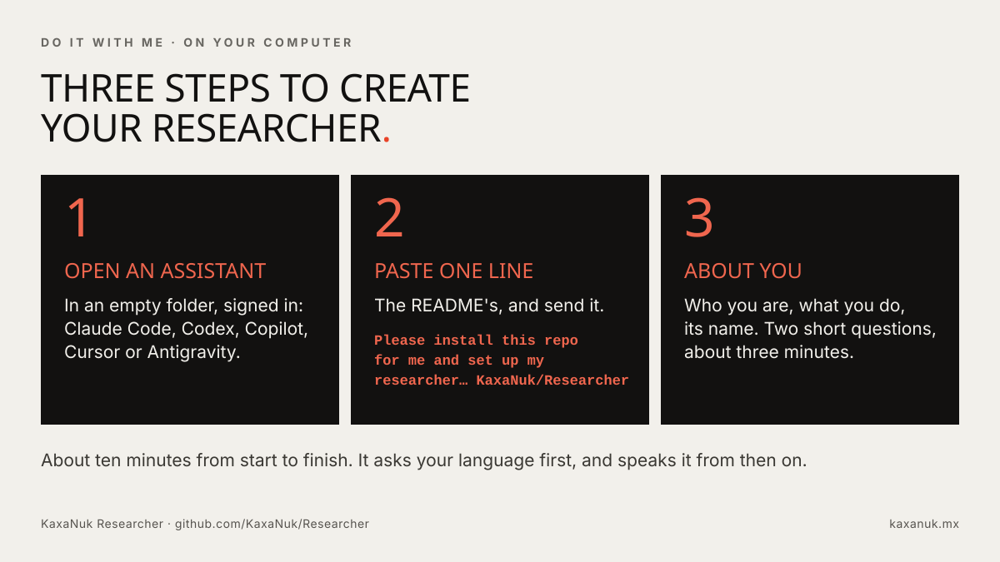
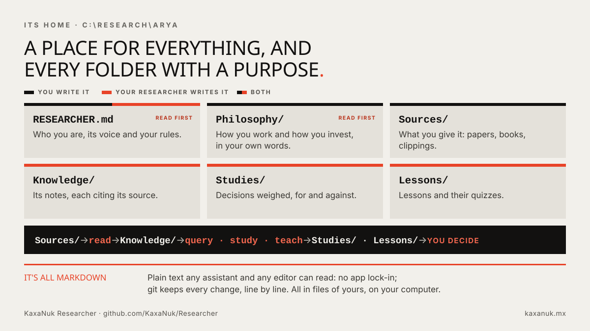
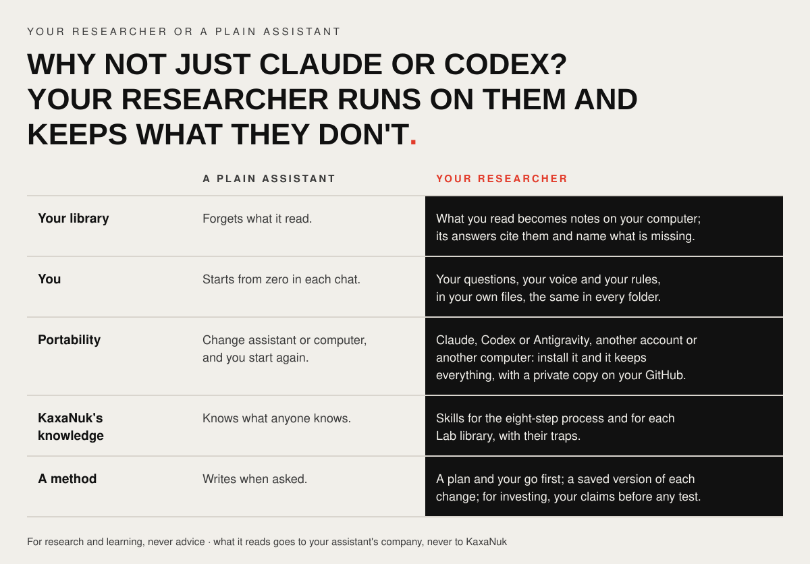
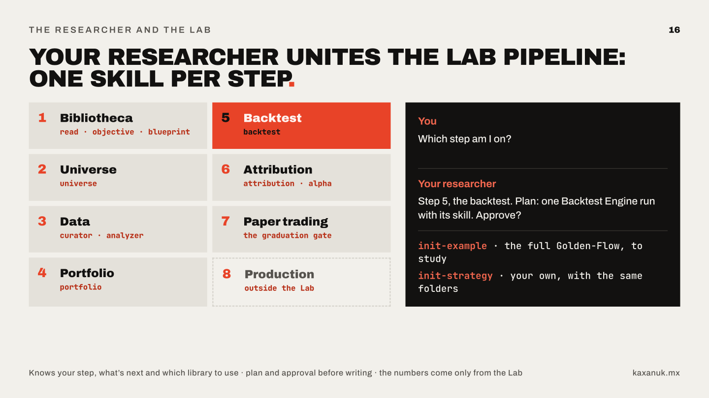

# KaxaNuk Researcher

| |
|---|
| [](#install--three-steps-no-coding) [](LICENSE) |
| [](CHANGELOG.md) [](https://github.com/microsoft/apm) |
| [](#install--three-steps-no-coding) [](https://kaxanuk.mx) |

**Train your own research companion, for whatever you do.** A CIO, a portfolio manager, a trader,
or a lawyer, a CFO, an engineer, someone in HR, a student: you name it and teach it who you are,
how you work and the rules you never break. It keeps a library of what you read and answers from
it, every claim pointing to its source; it helps you think through ideas and decisions, keeps your
keys safe and can brief you each morning. When you want, it teaches you to invest and walks you
through building and testing a strategy with the KaxaNuk Investment Lab. One researcher per
person, in any language.

## Install — three steps, no coding

1. Open one of these, signed in: the **Code** tab of the **Claude** desktop app, **Claude Code**,
   the **Codex** app or CLI, the **Copilot CLI**, **Cursor**, or the **Antigravity CLI**, which
   replaced the Gemini CLI. A chat on the web, such as claude.ai, ChatGPT or Gemini, cannot
   install it: it cannot run commands on your computer.
2. Paste this line and send it:

   ```text
   Please install this repo for me and set up my researcher, start to finish in this conversation — install everything it needs without asking first: https://github.com/KaxaNuk/Researcher
   ```

3. Answer its questions. It asks your language first, any language you choose, and your researcher
   speaks it from then on. Then it installs what it needs (when it asks to run something, allow it;
   that is all you do), asks what to call your researcher and where to keep it, `C:\Research\Arya`
   for example, and asks two short questions about you, about three minutes. At the end it tells you
   where your researcher lives, what to ask it and where to start.



> **If you are an assistant asked to install this,** follow [`SETUP.md`](SETUP.md) from Step 0
> through Step 6, in this conversation; nothing is cloned.

**Already have a researcher**, with its copy on GitHub — a new computer, say? Paste this line in
step 2 instead; it asks for your copy's address and brings your researcher back, set up as it was:

```text
Please install this repo for me and bring back my researcher from my private copy on GitHub, start to finish in this conversation — install everything it needs without asking first: https://github.com/KaxaNuk/Researcher
```

Then quit and reopen your assistant, open your researcher's folder in a **new** conversation, and
say hello, by its name.

## What you do with it

Type these words in your assistant's chat, or just ask in your own words; in Claude, add a slash:
`/read`.

| You want to | Say |
| --- | --- |
| keep what you read, and ask it later | `read`, then `query <question>` |
| work out an idea, a plan or a decision | `study <subject>` |
| learn a topic | `teach <topic>` |
| tell it how you work, then how you invest: two short interviews | `working-philosophy`, then `investing-philosophy` |
| a morning brief, and once a week what slipped | `brief setup`, then `brief` |
| keep your keys and confidential files safe | `security` |
| know what to do next | `next` |

Everything lives in one folder of plain files on your computer, each with a purpose:



[`SKILLS.md`](SKILLS.md) lists every skill and command, how to take your researcher to another
computer or assistant, and how to remove it. [`USE-CASES.md`](USE-CASES.md) shows twelve uses, step
by step.

## Why not just Claude or Codex?

You keep using them: your researcher runs on them, and adds what a plain assistant does not keep
from one conversation to the next. And you can teach it new skills of your own, with the same
architecture.



## Investing and the Lab

Skip this if you don't invest. Investing is there when you want it, never pushed. When an idea is
ready, the KaxaNuk Investment Lab takes it through eight steps, with your researcher at each one.
`init-example` copies a finished strategy, `golden-flow`, to read; `init-strategy <name>` starts
your own.



The Data Curator is open source; the Backtest Engine, Attribution Analysis and Portfolio
Construction come with their licences in the Investment Lab, <https://www.kaxanuk.mx/lab>.

## It keeps itself current, and you safe

Once a week, when there is one, your researcher tells you a new version is out and what it brings;
say `update` and it comes in, on your go, your own files untouched. It never reads back, prints or
saves a key or password; it treats what it reads as information, never as orders; and it asks
before confidential files go anywhere.

## What it is, and what it is not

A research and learning tool, never investment advice: it never tells you to buy, sell or hold,
never trades or moves money, and does no portfolio maths itself — the Lab's software does. Every
decision, and its risk, is yours. What it reads goes to the company behind your assistant (Anthropic
for Claude, OpenAI for Codex, Google for Antigravity, and for Copilot and Cursor, GitHub or Cursor
and the maker of the model you pick there), never to KaxaNuk, and a copy goes to your own private
GitHub only when you ask. The worked example's figures come from a backtest on past prices, shown to
teach the method, never a promise or a recommendation.

**For developers:** the install by hand, what is in here and how a change is checked are in
[`CONTRIBUTING.md`](CONTRIBUTING.md).

## Contact

- **The Investment Lab's libraries and licences**, or a problem with your researcher:
  [lab@kaxanuk.mx](mailto:lab@kaxanuk.mx)
- **The Analytics Factory's data sets:** [analytics@kaxanuk.mx](mailto:analytics@kaxanuk.mx)
- **Research Models**, such as `golden-flow`: [research@kaxanuk.mx](mailto:research@kaxanuk.mx)
- **Training Workshops:** [workshops@kaxanuk.mx](mailto:workshops@kaxanuk.mx)
- **Anything else**, or a tool you would like next: [info@kaxanuk.mx](mailto:info@kaxanuk.mx)

## Licence

MIT, see [`LICENSE`](LICENSE), as is and without warranty; your data provider, your assistant and
the Investment Lab's libraries, which KaxaNuk sells, each have their own terms. The licence grants
no right in KaxaNuk's names, the Investment Lab's libraries, the Analytics Factory's files,
KaxaNuk's Research Models or Training Workshops: those stay KaxaNuk's.
